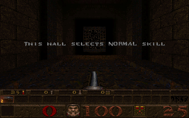

# Quake shareware on MS-DOS

**Quake 1.06 shareware runs with the x86 JIT on MS-DOS 6.22.** It renders
the start map, weapon and HUD and accepts keyboard movement. The 27 October 2026
headless smoke test matched the original health display, injected an Up-arrow
make/break through IRQ1 and captured two different 3D views. The second view
entered the normal-skill hall. Both captures remained in protected mode.



```sh
./run-quake.sh
```

The launcher selects the verified **JIT backend with 32 MiB RAM**.
Pass `--backend interpreter` to select the reference backend.
Use arrow keys to move; Ctrl fires, Space jumps, Escape opens the menu.
Sound, CD audio, joystick, DOS mouse and game networking are disabled in the
prepared AUTOEXEC.BAT. This is a silent keyboard-controlled session.
`QUAKE_DISK=/absolute/path/to/disk.qcow2` selects another prepared disk.

The JIT supports the original CWSDPMI startup and protected-mode gameplay.
A deferred native block previously reused a 16-bit stack address calculation
after SS.B changed, corrupting the saved DS selector during a DPMI request.
Deferred boundary blocks now validate stack and buffer assumptions just like
ordinary native blocks. A RAM-only regression alternates SS.B across repeated
far-transfer blocks and compares registers, segments and all RAM to the interpreter.

Headless validation completed all three original bundled timedemos: `demo1`
(969 frames), `demo2` (985), and `demo3` (1,090). Each result was confirmed in
its closed DOS console log. The start-map smoke also verified the original HUD,
keyboard movement, changing 3D frames and protected-mode state. See the
[compatibility record](measurements/quake-jit-2026-10-27.json). This validates
the JIT backend, including its normal interpreter fallbacks for unsupported
instructions; it does not claim every instruction runs natively or that the
entire game has been played through.

## Uncapped timedemo benchmark

```sh
./run-quake.sh --benchmark
./run-quake.sh --benchmark --demo demo2
./run-quake.sh --benchmark --frames 50
./run-quake.sh --benchmark --backend interpreter --frames 50
```

Benchmark mode discovers the embedded `.dem` files in `ID1/PAK0.PAK` and picks
the first by name (the original shareware selects `demo1`). It runs the original
Quake `timedemo` command headlessly, with the JIT, 32 MiB RAM, VGA
320x200, view size 100, no retrace wait and sound disabled. Playback is uncapped;
the renderer still executes normally and writes the emulated VGA framebuffer.
There is no frontend presentation or host frame-rate limiter in the measured
run. `--timeout SECONDS` changes the default 30-minute watchdog.

Use `--frames 50` for a quick stock-demo prefix. The wrapper preserves the
recording's initial signon/warmup messages, copies 50 timed messages intact and
adds a normal disconnect message. It retains `demo1-50.dem` in the result folder
and stages `ID1/PCBENCH.DEM` only in the private child; the original PAK and demo
are unchanged. Quake's actual reported count must equal the requested count or
the run fails. This prefix layout is intended for the bundled shareware demos;
third-party recordings may have different signon sequencing. Settings are loaded
from `PCBENCH.CFG` to stay within DOS's command-tail limit. A short prefix
measures the opening scene, so its FPS differs from a complete demo run.

Quake's [timedemo implementation](https://github.com/id-Software/Quake/blob/master/WinQuake/cl_demo.c)
excludes loading and its first frame, then prints frame count, elapsed seconds
and FPS. For this runner only, every PIT port/count/interrupt uses monotonic
host time at 1,193,182 ticks per second. This lets Quake's own FPS reflect host
throughput; normal emulator sessions retain their deterministic instruction
clock. This is a guest-reported measurement through the emulated PIT, rounded
to Quake's one-decimal output precision. Total boot-to-completion wall time is
reported separately in the JSON and does not define the FPS interval.

A private compressed overlay contains the benchmark AUTOEXEC and console log.
The runner observes DOS file-write/close handler entries, including CWSDPMI's
saved-vector calls, without patching the executable or reading a writable disk
from another process. Once the completed result's file close returns to the
32-bit client, it flushes and closes the emulator. It does not wait for Quake's
quit menu or require a GUI. The wrapper then reads the stopped guest's
`QCONSOLE.LOG` and confirms the result before printing FPS. A missing result,
failed log confirmation or watchdog expiry exits with failure, not a score.

Results and logs are saved in `build/quake-benchmark-*`. Successful runs remove
the scratch disk unless `--keep-disk` is supplied. The prepared disk and game
files are preserved. The standalone `pcemu --benchmark` synthetic CPU benchmark
keeps its existing meaning; use the Quake launcher for this timedemo mode.

For optimization work, `./run-quake.sh --profile --frames 50 --repeat 5` freezes
an optimized build and collects separate baseline timings, native host stacks
and guest opcode/x87 diagnostics. See [Quake profiling](quake-profiling.md) for
measurement boundaries, reproducibility and interpretation.

## Prepare the local disk

Downloaded game files, DOS images and private working disks remain ignored.
No game assets or Microsoft files are distributed with this repository.

Download [Quake 1.06 shareware](https://www.dosgamesarchive.com/file/quake/quake106)
from the [FU Berlin idstuff mirror](https://ftp.fu-berlin.de/pc/games/idgames/idstuff/quake/quake106.zip).
The archive SHA-256 must be
`ec6c9d34b1ae0252ac0066045b6611a7919c2a0d78a3a66d9387a8f597553239`.

```sh
mkdir -p build/quake
curl -fL https://ftp.fu-berlin.de/pc/games/idgames/idstuff/quake/quake106.zip \
  -o build/quake/quake106.zip
shasum -a 256 build/quake/quake106.zip
unzip -oq build/quake/quake106.zip -d build/quake/archive
7zz x -y build/quake/archive/resource.1 -obuild/quake/game
python3 tools/probe_quake.py --dos /absolute/path/to/local-dos-base.qcow2 \
  --source build/quake/game --prepare-only --output media/quake.qcow2
```

Use a stopped DOS base containing C:\DOS\HIMEM.SYS. Keep its backing chain
available. If the base lives on the SMB volume, first copy the compact standalone
QCOW2 locally: QEMU backing-file locking is unsupported on that mount. The
recovered DOS base occupies about 9 MiB; no multi-gigabyte raw image is needed.
This checkout's prepared disk uses `media/quake-dos-base.qcow2` as its parent.

Preparation refuses an existing output. It creates a private compressed child,
verifies the shareware PAK hash, stages and reads back QUAKE.EXE, CWSDPMI.EXE and
PAK0.PAK, then replaces CONFIG.SYS/AUTOEXEC.BAT only in that child. Quake runs
from C:\ with its assets in C:\ID1 and executables in C:\QUAKE. Its default
`./id1` path resolves correctly there. The initial `-basedir C:\` experiment
failed to load the assets and is no longer used.

## Validate headlessly

```sh
python3 tools/smoke_quake.py --backend jit
python3 tools/smoke_quake.py --backend interpreter
# One bounded cold-boot capture, without claiming gameplay automatically:
python3 tools/probe_quake.py --dos media/quake-dos-base.qcow2 \
  --source build/quake/game --no-jit --steps 700000000 --timeout 90
# Use --demo to play the original bundled demo1 instead of the start map.
```

The smoke uses a temporary compressed overlay of the prepared disk, selects the
JIT by default and checks the original 320x200 health-display pixels. It pauses to
capture the first view, holds the forward key for at least 100 million guest
instructions and verifies a changed 3D scene in a second capture. It checks
protected-mode state and an orderly emulator exit. Success removes its disk;
failure retains it for diagnosis. Reports, frames and logs live under
`build/quake-smoke-*`. The image above is a direct emulator framebuffer capture.
This is a compatibility check, not a benchmark or a complete playthrough.

The generic startup probe retains failed disks and removes a normally completed
capture disk unless `--keep-disk` or `--output` is given. Exit zero alone means
only that the instruction budget completed.

## Implemented CPU support and limits

CWSDPMI bootstraps through 386 TSS far JMP/CALL transfers. The CPU now saves and
loads general registers, segments, EIP, flags, CR3 and LDT state; maintains TSS
busy bits and nested-task backlinks; handles NT IRET returns; and sets CR0.TS
for lazy floating-point switching. Focused tests cover the transfer and return.
16-bit TSS task switching and complete task-switch exception validation remain
outside this implementation.

The x87 interpreter covers real/integer loads and stores, stack arithmetic and
comparisons, integer rounding modes, common transcendental instructions and
FSAVE/FRSTOR. BIOS and CMOS report an installed coprocessor. Snapshot schema 9
preserves register values, control/status/tag words and environment fields;
versions 1–8 restore default FINIT floating-point state. Tests exercise rounding
ties, operand order, comparisons on read-only pages, a status store at a page
boundary, 80-bit memory stores, save/restore and snapshot compatibility.

Arithmetic uses binary64 internally. Bit-exact 387 extended precision, precision
control, full exception/stack-fault semantics and instruction/data-pointer
tracking remain incomplete. This is sufficient for the verified Quake workload;
it is not full 80387 conformance.

The [386 task/x87 specification checks](x86-task-x87.md) document the pinned
Intel references, RAM-only tests and conformance boundaries in more detail.
